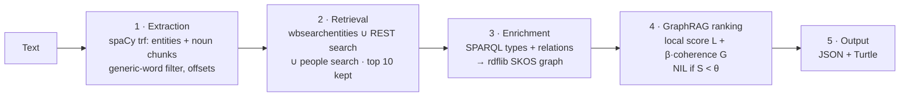

# wdlink

[](https://github.com/yoannnglnad/wdlink/actions/workflows/ci.yml)

**Text-to-Wikidata entity linking with a GraphRAG re-ranker over a local RDF/SKOS graph.**

`wdlink` finds the meaningful terms in an English text and links each one to a Wikidata item (QID). Candidates come from the Wikidata search APIs. For each document, `wdlink` builds a small SKOS graph around the candidates and uses it to choose the reading that fits the context. Every link comes with a calibrated confidence, the alternatives considered, and the evidence behind the choice. No local copy of Wikidata is needed.

```console
$ uv run wdlink link "Marie Curie conducted research on radioactivity in Paris and won the Nobel Prize in Physics."
Mention                 Candidate concept       Wikidata ID  Score  Confidence  Decision
Marie Curie             Marie Curie             Q7186        0.89   0.999       linked
radioactivity           radioactivity           Q11448       0.79   0.970       linked
Paris                   Paris                   Q90          0.73   0.907       linked
Nobel Prize in Physics  Nobel Prize in Physics  Q38104       0.76   0.996       linked
```

Context wins over popularity. In *"Paris, son of Priam, abducted Helen and started the Trojan War."*, Paris is linked to the Trojan prince (Q167646) and Helen to Helen of Troy (Q164061).

## Highlights

- **A graph the ranker actually uses.** Each candidate's neighbourhood is read from Wikidata into an rdflib graph modelled in SKOS. From it come retrieved facts for text matching and coherence links between mentions.
- **Measured, not assumed.** All 25 design choices are recorded as decision records. Each is backed by a benchmark (5-fold cross-validation, bootstrap intervals, McNemar tests) or by an explicit reason why it cannot be benchmarked.
- **Explainable output.** For each link, the JSON gives the feature scores, the graph facts that were retrieved, and the Wikidata statement behind any coherence bonus (e.g. *Marie Curie —residence→ Paris*).
- **Reproducible.** The exact Wikidata snapshot behind the published numbers is committed (8 MB), and an offline run reproduces them exactly.

## Quick start

Requirements: Python 3.12, [uv](https://docs.astral.sh/uv/), and network access to Wikidata on the first run.

```bash
uv sync                                    # installs everything, incl. spaCy en_core_web_trf and en_core_web_sm
uv run wdlink link "Your text here" --json out.json --ttl graph.ttl
```

The first run downloads the models (about 0.6 GB) and fills a local Wikidata cache in `.cache/wikidata/`. Once the models are loaded and the entities cached, a document takes about half a second on a laptop.

## Usage

### Command line

| Command | What it does |
|---|---|
| `wdlink link "text"` / `--file doc.txt` | Links a text and prints the table above |
| `  --json out.json` | Writes the structured result |
| `  --ttl graph.ttl` | Writes the document's RDF/SKOS graph (Turtle) |
| `  --no-graph` | Text-only baseline, for comparison |
| `  --spacy-model en_core_web_sm` | 15 MB pipeline instead of the 501 MB transformer |
| `  --offline` | Uses only the Wikidata and model caches |
| `wdlink eval [--offline]` | Evaluates on the gold splits and writes `eval/results/` |
| `wdlink bench <suite>\|all\|micro\|evidence` | Runs the design benchmarks on the dev split and writes `eval/benchmarks/` |

### Python

```python
from wdlink.pipeline import Linker

text = "Marie Curie conducted research on radioactivity in Paris and won the Nobel Prize in Physics."
result, graph = Linker().link(text)
for m in result["mentions"]:
    print(m["mention"], m["selected"] and m["selected"]["qid"], m["confidence"])
graph.serialize("graph.ttl", format="turtle")   # rdflib.Graph
```

All settings are dataclasses in `src/wdlink/config.py`:

- `PipelineConfig` covers extraction and retrieval: spaCy model, embedding model, search APIs and depth, candidate budget, graph facts.
- `RankingConfig` covers the weights, β, the NIL threshold and the confidence temperature.

### Output

Each mention in the JSON looks like this (excerpt from `examples/marie_curie.json`):

```json
{
  "mention": "Paris", "start": 51, "end": 56, "decision": "linked",
  "selected": {"qid": "Q90", "label": "Paris", "description": "capital and most populous city in France", "score": 0.7343},
  "confidence": 0.9073,
  "evidence": {
    "features": {"txt": 0.5813, "name": 1.0, "type": 0.5, "pop": 1.0, "local": 0.7157, "coherence": 0.1864},
    "card": "Paris, capital and most populous city in France. award received: Companion of the Liberation; …",
    "graph_links": [{"mention": "Marie Curie", "qid": "Q7186", "relatedness": 1.0, "direct": [["P551", "in"]]}]
  },
  "alternatives": [
    {"qid": "Q167646", "label": "Paris", "description": "mythological son of Priam, king of Troy", "score": 0.6348},
    {"qid": "Q830149", "label": "Paris", "description": "city in and county seat of Lamar County, Texas, United States", "score": 0.6166}
  ]
}
```

- `decision` is `linked`, or a NIL reason: `nil_low_score` or `nil_no_candidate`.
- The Turtle file holds:
  - candidates and their neighbours as `skos:Concept`, mapped with `skos:exactMatch` to Wikidata;
  - instance-of, subclass-of and part-of as specialised `skos:broader` sub-properties;
  - mentions as NIF phrases, linked with ITS 2.0 (`itsrdf:taIdentRef`, `itsrdf:taConfidence`);
  - the run as a `prov:Activity`.

## How it works



| Stage | What it does |
|---|---|
| 1. Extraction | Named entities and specific noun phrases, with character offsets. One-word common nouns with Zipf frequency ≥ 3.5 ("research") are dropped. |
| 2. Retrieval | Two search APIs, top 20 each, plus a human-only search for bare names ("Lincoln"). Housekeeping items are removed, and a cheap pre-ranking keeps 10 candidates per mention. |
| 3. Enrichment | Two batched SPARQL queries fetch types and item-valued statements. rdflib turns them into the document's SKOS graph, and the ranker reads a NetworkX view of it. |
| 4. Ranking | See below. |
| 5. Output | JSON with evidence, and the Turtle graph with the decisions written back as ITS annotations. |

The ranking in stage 4 combines a local score and a coherence bonus:

```
L = 0.50·text + 0.20·name + 0.15·type + 0.15·popularity
S = L + β·G        (β = 0.10, θ = 0.38, tuned on dev)
```

- **text** compares the context with the candidate's description plus the 3 graph facts closest to the context. This is the retrieval-augmented part.
- **G**, the coherence, rewards a candidate linked by a direct statement, or by rare shared neighbours, to the likely readings of the other mentions.

The full write-up is [`docs/architecture.md`](docs/architecture.md), two pages.

## Results

Thresholds are tuned on the dev split only; test and KORE50-DYWC are held out.

| | First search hit | Text-only baseline | **GraphRAG** |
|---|---|---|---|
| Test accuracy (97 mentions) | 0.691 | 0.918 | **0.938** |
| Test, ambiguous mentions | 0.395 | 0.816 | **0.868** |
| Test, end-to-end F1 | – | 0.785 | **0.806** |
| KORE50-DYWC accuracy (141 hard mentions) | 0.227 | 0.518 | **0.567** |
| KORE50-DYWC, end-to-end F1 | – | 0.497 | **0.552** |

What the numbers say:

- **The graph helps most where text is ambiguous.** On test, the gain is +5.2 points on ambiguous mentions. On KORE50, GraphRAG fixes 11 baseline errors and causes 4. Neither gain is statistically significant on its own at these sample sizes (McNemar p = 0.50 and 0.12).
- **Popularity, text and name do most of the work.** The graph acts as a tie-breaker. Removing popularity costs 12 points.
- **Retrieval is the bottleneck on hard text.** On KORE50, the right item is among the candidates for only 84% of mentions, and for 71% after the cut to 10.

Full tables, ablations and calibration are in [`eval/results/results.md`](eval/results/results.md).

## Reproducing the results

```bash
scripts/cache_snapshot.sh restore      # checks the SHA-256 and unpacks the 22–23 Oct 2026 Wikidata snapshot
uv run wdlink eval --offline           # no network: reproduces eval/results/results.json exactly
uv run wdlink bench coherence          # any design benchmark (see docs/adr/)
```

The KORE50-DYWC split is not distributed (see the data notes below). Without it, `wdlink eval` runs on dev and test only.

## Design decisions

[`docs/adr/`](docs/adr/README.md) holds 25 decision records. Each gives the options compared, the measurements and the reason for the choice. Six choices changed because of their benchmark:

| Choice | Before → after | Evidence |
|---|---|---|
| Extraction model | spaCy `sm` → `trf` | end-to-end F1 +3.4 [+0.5, +6.7] |
| Generic-word cut-off | Zipf 4.5 → 3.5 | end-to-end F1 +4.4 [+1.7, +7.1] |
| Entity types | spaCy NER labels → casing rule | NER labels cost 7.3 points with `sm` (p = 0.001) |
| Graph facts in the candidate card | all facts → 3 closest to the context | all facts dilute the embedding of well-described items |
| Short-mention query expansion | on → off | fired twice on dev, both times wrongly |
| Graph view for the ranker | SPARQL over rdflib → triple scan | 222 ms → 1.5 ms per document, identical edges |

Raw benchmark tables: [`eval/benchmarks/`](eval/benchmarks/). Measurements behind the other factual claims: [`eval/benchmarks/evidence.md`](eval/benchmarks/evidence.md).

## Project layout

```
src/wdlink/
  extract.py      1. term extraction
  retrieve.py     2. candidate retrieval and pre-ranking
  wikidata.py        Wikidata client: rate limit, retries, per-entity cache
  graph.py        3. RDF/SKOS graph, NetworkX view, fact verbalisation
  features.py     4. local features
  rank.py         4. coherence, NIL decision, confidence
  pipeline.py        orchestration and JSON output
  evaluate.py     5. evaluation (retrieval recall, D2KB, A2KB, McNemar, calibration)
  bench.py, microbench.py, evidence.py   design benchmarks
  config.py          every constant, weight and threshold
docs/architecture.md   two-page architecture and ranking strategy
docs/adr/              decision records
eval/                  gold data and annotation guideline, results, benchmarks, cache snapshot
examples/              JSON and Turtle outputs for the two example texts
tests/                 48 tests
```

## Development

```bash
uv run pytest                     # 48 tests; 2 need network access or a warm cache (-m "not network" skips them)
uv run ruff check src tests && uv run ruff format --check src tests
uvx ty@0.0.91 check src           # type checking
```

CI (`.github/workflows/ci.yml`) runs lint, formatting, type checking and the offline tests. On Linux, torch is installed from the CPU wheel index.

## Limitations

- **Small evaluation sets.** Dev has 191 mentions and test has 97. They are single-annotated, although every gold QID was verified against the live API. Differences of a few points are within noise.
- **Namesakes of unknown entities.** Half of the hard NILs (invented entities named like real ones) are still linked to a namesake. The popularity prior also favours well-known items over long-tail ones.
- **Span boundaries come from spaCy.** In "Marie Curie won the Nobel Prize in Physics.", `trf` returns "Nobel Prize" and "Physics" as two mentions, so the prize links to the generic Nobel Prize (Q7191). The longer sentence above keeps it whole.
- **Retrieval caps accuracy on hard text** (see Results). Deeper search (CirrusSearch, 20 candidates) is the first lever.
- **Typing is the open question.** NER typing with `trf` labels scores higher on test and KORE50 but not on dev, so it is not the default. It is the first thing to re-test with a larger dev split.
- **No LLM in the core.** This keeps the graph's contribution measurable and the runs reproducible. An LLM re-ranker for low-margin mentions is the natural extension.

## Data notes

- **Wikidata data** is CC0, including the committed cache snapshot.
- **KORE50-DYWC** annotations have no explicit licence. The converted file and the per-mention KORE50 errors are kept out of the repository. `eval/scripts/convert_kore50.py` rebuilds the split from the archive documented in [`eval/README.md`](eval/README.md), which also describes the annotation guideline and the dev and test statistics.
